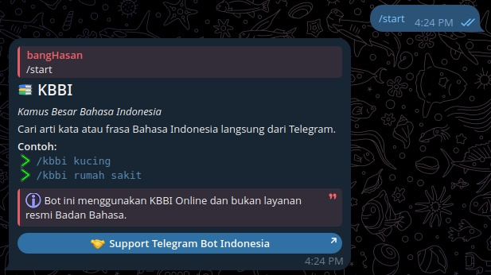
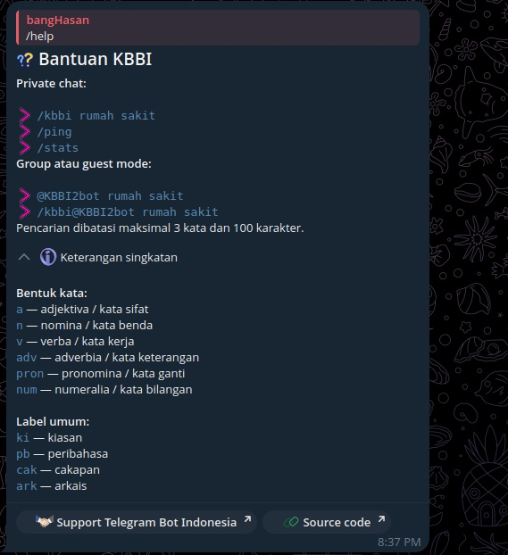
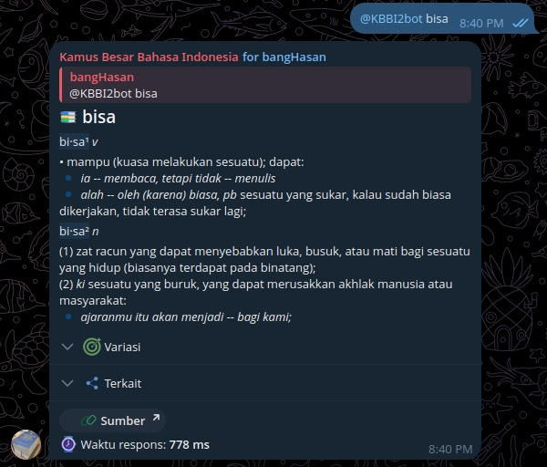

# KBBI Telegram Bot

Bot Telegram berbahasa Indonesia untuk mencari arti kata dan frasa dari [KBBI Online](https://kbbi.web.id/).

> **Catatan:** Bot ini menggunakan KBBI Online dan bukan layanan resmi dari kementrian pendidikan.

## Tentang proyek

| Informasi | Detail |
|---|---|
| Nama bot | KBBI |
| Username | [`@KBBI2bot`](https://t.me/KBBI2bot) |
| Tagline | Kamus Besar Bahasa Indonesia |
| Platform | Telegram Serverless |
| Lisensi | [AGPL-3.0-or-later](LICENSE) |

Bot mengambil data definisi melalui endpoint JSON KBBI Online. Corpus KBBI tidak disimpan di repository.

## Fitur

- Pencarian kata dan frasa melalui `/kbbi <kata/frasa>`.
- Guest mode melalui `@KBBI2bot <kata/frasa>`.
- Definisi utama tampil langsung; contoh, variasi, sublema, dan kata turunan tersedia dalam bagian expandable.
- Pesan status sementara sebelum pencarian selesai, kemudian diedit menjadi hasil akhir.
- Waktu respons adaptif dalam milisecond atau detik.
- `/ping` untuk mengukur waktu respons sederhana.
- `/stats` untuk melihat metrik agregat di private chat.
- Rich message dengan custom emoji dan rich message button.
- Cache, rate limit, concurrency limit, dan single-flight untuk query identik.
- Error reporting ke grup/topic log khusus tanpa mengirim data pribadi pengguna.

## Contoh penggunaan

### Private chat

```text
/start
/help
/kbbi kucing
/kbbi rumah sakit
/ping
/stats
```

### Group atau guest mode

```text
@KBBI2bot rumah sakit
/kbbi@KBBI2bot rumah sakit
```

Batas pencarian adalah maksimal 3 kata dan 100 karakter. Mention bot tidak membedakan huruf besar dan kecil.

## Tampilan

### `/start`

[](screenshot/kbbi_start.jpg)

### `/help`

[](screenshot/kbbi_help.jpg)

### Guest mode dan hasil pencarian

[](screenshot/kbbi_guest_mode.jpg)

## Dokumentasi

- [Ringkasan proyek](docs/readme/01-overview.md)
- [Cara penggunaan](docs/readme/02-usage.md)
- [Panduan pengembangan](docs/readme/03-development.md)
- [Deployment](docs/readme/04-deployment.md)
- [Operasional dan metrik](docs/readme/05-operations.md)
- [Keputusan lisensi](docs/readme/06-license.md)
- [Konsep produk](docs/concept.md)
- [Daftar issue](docs/issues/)
- [Dokumentasi SDK Telegram Serverless](docs/tgcloud-sdk.md)

## Pengembangan lokal

Prasyarat:

- Node.js dan npm.
- Akses Telegram Serverless melalui CLI `tgcloud`.

Instalasi dan pengujian:

```bash
npm install
npm test
```

Perintah deployment:

```bash
npx tgcloud login
npx tgcloud status
npm run deploy
npx tgcloud migrate
```

`npm run deploy` membaca konfigurasi lokal dari `.env`, membuat `runtime-config.js` yang di-ignore Git, lalu menjalankan `tgcloud push`. Gunakan `.env.example` sebagai template konfigurasi.

Perubahan schema database hanya diterapkan melalui `tgcloud migrate`. Jangan menyimpan token atau secret di repository.

## Lisensi dan sumber data

Kode dan dokumentasi proyek menggunakan [GNU AGPL-3.0-or-later](LICENSE). Data definisi berasal dari KBBI Online dan tetap tunduk pada ketentuan sumbernya.
